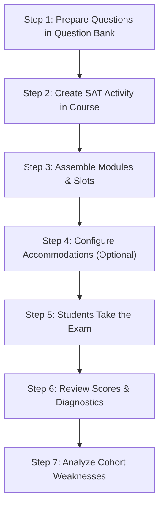

# SAT Exam Simulator for Moodle (`mod_sat`)

> **Digital SAT® Practice & Multi-Stage Adaptive Testing Engine for Moodle 5.2+**
> 
> [**العربية (النسخة العربية ودليل المعلم)**](README_AR.md) | [Technical Plan](TECHNICAL_PLAN.md)

---

## Overview

**SAT Exam Simulator (`mod_sat`)** is a native, production-ready Moodle 5.2+ activity plugin designed for high schools, test preparation centers, and educators. It delivers computer-based digital SAT practice exams featuring **Multi-Stage Adaptive Testing (MST)**, realistic timing and pacing, built-in self-hosted math tools, comprehensive student diagnostic score reports, and class-wide cohort analytics.

### Key Highlights

- **Multi-Stage Adaptive Testing (MST)**: Accurately mirrors digital SAT routing: student performance on Module 1 dynamically routes them to either an **Easy** or **Hard** Module 2.
- **Official-Style Scoring (400–1600)**: Scaled 200–800 section scores calculated with authentic psychometric tables and automatic sync to the Moodle Gradebook.
- **Flexible Pacing Modes**:
  - **Continuous Sitting**: Official mock test simulation running all modules back-to-back with a scheduled 10-minute break.
  - **Paced / Multi-Session**: Ideal for weekly homework and modular practice. Students complete Module 1, pause, and unlock their adaptively routed Module 2 later.
- **100% Self-Hosted & Open Source**:
  - Built-in draggable **Graphing & Scientific Calculator** (HTML5 Canvas + JavaScript math engine). Zero commercial API dependencies (no Desmos API key required).
  - Built-in SVG **Math Reference Sheet** containing all standard formulas.
  - Interactive **Option Eliminator** ($ABC$ strike-out) and live **Student-Produced Response (SPR)** validation.
- **Moodle 5.2 Native Architecture**:
  - Full compatibility with Moodle 5.2's Question Bank architecture (`mdl_question_references`).
  - Native Moodle Question Engine integration (`question_usage_by_activity`).
  - Complete Accommodations/Overrides system (1.5x, 2.0x time multipliers).
  - Full Moodle 2 Backup & Restore integration and GDPR Privacy API compliance.
- **Diagnostic Score Reports & Cohort Analytics**:
  - Student score reports mapped to the **8 official SAT content domains**.
  - Teacher dashboard with score distributions, routing rates, and class-wide domain weakness heatmaps for targeted classroom remediation.

---

## SAT 101: A Beginner's Primer for Teachers

If you or your department are new to the digital SAT, here is how the exam works:

```
[ Section 1: Reading & Writing ]
   ├── Module 1 (Routing Module - Standard mix of questions)
   └── Module 2 (Adaptive Stage)
          ├── Easy Module 2 (For scores below threshold)
          └── Hard Module 2 (For scores at or above threshold)
   [ Optional 10-Minute Break in Full Exam Mode ]
[ Section 2: Math ]
   ├── Module 1 (Routing Module - Standard mix of questions)
   └── Module 2 (Adaptive Stage)
          ├── Easy Module 2 (For scores below threshold)
          └── Hard Module 2 (For scores at or above threshold)
```

### 1. Multi-Stage Adaptive Testing (MST)
Unlike linear tests where every student answers identical questions, the digital SAT adapts between modules:
- Every student starts with **Module 1** (a balanced mix of easy, medium, and hard questions).
- The student's score in Module 1 determines their route:
  - If they achieve $\ge 60\%$ (configurable), they are routed to **Module 2 Hard**. Routing to Hard unlocks the highest score bands (up to 800 per section).
  - If they achieve $< 60\%$, they are routed to **Module 2 Easy**. Scores are capped to lower bands (typically 200–600).

### 2. Scoring Structure
- **Reading and Writing**: Scaled from **200 to 800**.
- **Math**: Scaled from **200 to 800**.
- **Total Composite Score**: Sum of both sections, ranging from **400 to 1600**.

### 3. Question Formats
- **Multiple Choice (MCQ)**: 4 options ($A, B, C, D$) with a single correct choice.
- **Student-Produced Response (SPR / Grid-ins)**: Open-ended numerical or fractional answers in the Math section (e.g. `2/3`, `0.667`, `-4/5`).

---

## Step-by-Step Teacher Wizard Guide

Follow these 7 steps to configure and run your first SAT practice exam:



---

### Step 1: Prepare Questions in Moodle's Question Bank

Before creating your exam activity, create your questions in Moodle's **Question Bank** (`Course > Question bank`):

#### A. Multiple-Choice Questions (MCQ)
1. Add a standard **Multiple Choice** question.
2. Select **One answer only**.
3. Provide 4 answer choices ($A, B, C, D$) and assign 100% grade to the correct choice.

#### B. Math Student-Produced Responses (SPR / Grid-in)
1. Add a **Short answer** or **Numerical** question.
2. Enter the canonical answer (e.g., `2/3` or `0.75`).
3. The plugin automatically accepts equivalent forms:
   - Fractions and decimals: `2/3`, `.6666`, `.6667`, `0.666`, `0.667` are all recognized as correct.
   - Negative numbers (up to 6 characters, e.g. `-10.5` or `-7/12`).
   - Positive numbers (up to 5 characters, e.g. `3.141` or `15/16`).

#### C. Formatting Split-Screen Reading Passages
For Reading & Writing questions, place a horizontal rule (`<hr>` or the **Horizontal line** button in the Atto/TinyMCE editor) between your passage and the question stem:

```html
<p>In 1928, Alexander Fleming observed a mold that killed bacteria...</p>
<hr>
<p>Which choice best describes the main idea of the passage?</p>
```
The exam simulator automatically splits this into a **two-column layout**: the passage appears on the left, and the question with choices appears on the right.

#### D. Tagging Questions with SAT Domains
To unlock student diagnostic reports and cohort analytics, add a tag to each question corresponding to the official SAT domain:
- Reading & Writing:
  - `sat_domain:craft_structure` (Words in Context, Text Structure and Purpose)
  - `sat_domain:information_ideas` (Central Ideas, Command of Evidence)
  - `sat_domain:standard_english` (Boundaries, Form, Structure, and Sense)
  - `sat_domain:expression_ideas` (Rhetorical Synthesis, Transitions)
- Math:
  - `sat_domain:algebra` (Linear equations, Linear inequalities, Systems)
  - `sat_domain:advanced_math` (Nonlinear functions, Quadratics, Polynomials)
  - `sat_domain:problem_solving_data` (Ratios, Rates, Percentages, Probability)
  - `sat_domain:geometry_trig` (Area, Volume, Right triangles, Circle theorems)

---

### Step 2: Create a New SAT Activity in Your Course

1. Turn on **Edit mode** in your Moodle course.
2. Click **Add an activity or resource** and select **SAT Exam Simulator**.
3. Configure the settings:

| Setting | Recommendation | Description |
|---|---|---|
| **Exam Name** | *Official Practice Exam 1* | Activity title shown on the course page. |
| **Exam Scope** | **Full SAT Exam** | Choose *Full SAT* (RW + Math), *Math Only*, *RW Only*, or *Single Module Practice*. |
| **Session Pacing** | **Continuous Sitting** | Choose *Continuous* for realistic timed mock exams, or *Paced / Multi-Session* for modular homework assignments. |
| **Routing Mode** | **Adaptive (MST)** | Keeps official adaptive routing enabled. |
| **Routing Threshold** | **60%** (Default) | Percentage score on Module 1 required to route student to Hard Module 2. |
| **Timing** | 32 min/module (RW)<br>35 min/module (Math) | Standard official timing per module. |
| **Attempts Allowed** | 1 (or more) | Maximum attempts a student can make. |
| **Grading Method** | Highest grade | Aggregation method across multiple attempts. |

4. Click **Save and display**.

---

### Step 3: Assemble Modules and Assign Questions

On the activity page, click **Manage Questions** (`edit.php`):

1. You will see tabs for each module depending on the chosen exam scope:
   - **Reading & Writing: Module 1 (Routing)**
   - **Reading & Writing: Module 2 (Easy)**
   - **Reading & Writing: Module 2 (Hard)**
   - **Math: Module 1 (Routing)**
   - **Math: Module 2 (Easy)**
   - **Math: Module 2 (Hard)**
2. Select a module tab.
3. In the **Add Question Slot** form at the bottom:
   - Select a question from your Question Bank.
   - Set the point value (default: `1.00`).
   - Click **Add slot**.
4. Use the arrow icons (`↑` / `↓`) to rearrange questions, or `✕` to remove slots.
5. Standard question counts for an official SAT test:
   - Reading & Writing: **27 questions per module** (54 total across 2 modules).
   - Math: **22 questions per module** (44 total across 2 modules).

---

### Step 4: Configure Accommodations & Overrides (Optional)

If you have students with IEP, 504, or testing accommodations (such as extended time):

1. On the activity page, click **Overrides and Accommodations** (`overrides.php`).
2. Click **Add user accommodation override**.
3. Select the student and configure their accommodation:
   - **Time multiplier**:
     - `1.0x`: Standard time.
     - `1.5x`: 50% extended time (Time and a half).
     - `2.0x`: 100% extended time (Double time).
   - **Attempts allowed**: Grant additional attempts if required.
4. Click **Save override**.

---

### Step 5: How Students Experience the Exam Simulator

When students start an attempt, they enter a distraction-free, full-screen exam runner:

- **Top Navigation Bar**:
  - **Countdown Timer**: Server-authoritative timer. When remaining time drops below 5 minutes, the timer turns red with an alert. Students can click *Hide* if they prefer to reduce anxiety.
  - **Reference Sheet**: Opens a modal with all official Math geometric and algebraic formulas.
  - **Calculator**: Opens a draggable scientific and graphing calculator.
- **Split-Screen Layout**:
  - Passages appear on the left column with clean typography and scrolling.
  - Questions, answer options, and navigation buttons appear on the right column.
- **Option Eliminator**:
  - Students can toggle the Option Eliminator ($ABC$) button to strike through options they have ruled out.
- **Student-Produced Response (SPR) Live Validator**:
  - Numerical inputs only permit valid mathematical characters (`0-9`, `.`, `/`, `-`).
  - Real-time feedback alerts students if a fraction or decimal exceeds character length.
- **Question Matrix Drawer**:
  - Students can open the drawer to view all questions at a glance, jump to any question, and flag questions for review before submitting the module.

---

### Step 6: Grading, Review & Student Diagnostic Reports

1. **Automatic Scoring & Gradebook Sync**:
   - As soon as a student completes their exam, raw scores are converted into official scaled scores (200–800 section, 400–1600 composite).
   - The final score is immediately posted to the Moodle Gradebook (`grade_update`).
2. **Student Diagnostic Score Report (`diagnostic.php`)**:
   - Students and teachers can view a comprehensive score card:
     - Reading & Writing scaled score (out of 800).
     - Math scaled score (out of 800).
     - Total composite score (out of 1600).
     - **8 Domain Mastery Bars**: Displays accuracy percentages and color-coded mastery badges (**Mastered**, **Proficient**, or **Needs Practice**) across all SAT domains.
     - One-click **Print Score Report** button for parent-teacher conferences.
3. **Question-by-Question Review (`review.php`)**:
   - Review every question with the student's selected answer, the correct answer, and full teacher explanations.

---

### Step 7: Teacher Cohort Analytics Dashboard

Teachers can access deep classroom insights by clicking **Cohort Analytics** (`analytics.php`):

1. **Cohort KPI Cards**:
   - Total finished submissions.
   - Class average composite score, highest score, and lowest score.
   - Section averages for Reading & Writing and Math.
2. **Score Distribution Chart**:
   - Visual breakdown across SAT score bands:
     - `1400–1600`: Highly Competitive / Ivy League benchmark.
     - `1200–1390`: Competitive / Honors benchmark.
     - `1000–1190`: National Average / Proficient.
     - `800–990`: Developing.
     - `400–790`: Foundational remediation required.
3. **Adaptive Routing Performance**:
   - Reading & Writing: % of students routed to Hard Module 2 vs Easy Module 2.
   - Math: % of students routed to Hard Module 2 vs Easy Module 2.
4. **Domain Weakness Heatmap**:
   - Color-coded classroom accuracy across all 8 SAT domains.
   - Instantly highlights domains requiring immediate lesson review and targeted practice.

---

## Technical Specifications

- **Moodle Compatibility**: Moodle 5.2 and higher (Moodle 5.2, 5.3, etc.).
- **PHP Requirements**: PHP 8.3 or PHP 8.4+.
- **Database Support**: MySQL 8.4+, MariaDB 10.11+, PostgreSQL 16+.
- **Zero Third-Party API Reliance**: Graphing calculator and formula reference sheets run 100% in-browser on client JavaScript and HTML5 Canvas.
- **Privacy & GDPR**: Implements `core_privacy\local\metadata\provider` and `core_privacy\local\request\plugin\provider` for full data export and erasure.
- **Backup & Restore**: Native Moodle 2 XML backup and restore handlers for seamless course imports/exports.

---

## Disclaimer

*SAT® is a registered trademark of the College Board, which is not affiliated with and does not endorse this plugin. This software is an independent educational tool designed solely for practice, instruction, and simulation purposes.*

---

## License

This program is free software: you can redistribute it and/or modify it under the terms of the **GNU General Public License (GPL) version 3** or any later version as published by the Free Software Foundation.
