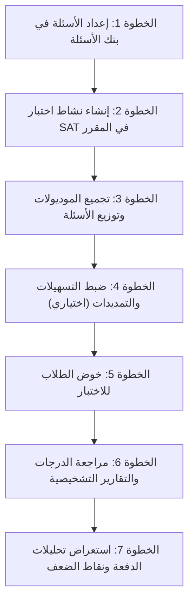

# محاكي اختبار SAT الرقمي لنظام مودل (`mod_sat`)

> **محرك اختبارات SAT® الرقمية التدريبية ونظام الاختبار التكيفي متعدد المراحل (MST) لمودل 5.2 فما فوق**
> 
> [**English Version (README.md)**](README.md) | [الخطة الفنية (TECHNICAL_PLAN.md)](TECHNICAL_PLAN.md)

---

## نظرة عامة

**محاكي اختبار SAT (`mod_sat`)** هو إضافة نشاط برمجية أصلية ومتكاملة لمنصة مودل 5.2+، صُممت خصيصاً للمدارس الثانوية، ومدارس الدبلومة الأمريكية، ومراكز التدريب على اختبارات القبول الجامعي. تتيح الإضافة للأساتذة تقديم اختبارات تجريبية حاسوبية تحاكي الاختبار الرقمي الرسمي بالكامل عبر **نظام الاختبار التكيفي متعدد المراحل (Multi-Stage Adaptive Testing - MST)**، مع تحكم دقيق في التوقيت والوتيرة، وأدوات رياضيات مفتوحة المصدر ومستضافة محلياً بالكامل، وتقارير تشخيصية للطلاب، ولوحة تحليلات تفصيلية للدفعة.

### أبرز المميزات

- **نظام الاختبار التكيفي متعدد المراحل (MST)**: يماثل آلية التوجيه في اختبار SAT الرقمي بدقة؛ حيث تحدد نتيجة الطالب في الموديول الأول (Module 1) توجيهه تلقائياً إلى موديول ثانٍ **سهل (Easy)** أو **متقدم (Hard)**.
- **نظام درجات رسمي معتمد (400–1600)**: احتساب الدرجات المعيارية لكل قسم (200–800) وفق جداول القياس النفسي والتربوي الرسمية، مع مزامنة فورية وتلقائية مع دفتر درجات مودل (Gradebook).
- **مرونة تامة في وتيرة الاختبار**:
  - **جلسة مستمرة (Continuous Sitting)**: محاكاة كاملة لظروف الامتحان الرسمي بجلسة واحدة متصلة وفاصل زمني مجدول مدته 10 دقائق.
  - **جلسات متعددة مقسمة (Paced / Multi-Session)**: ميزة مثالية للواجبات الأسبوعية والتدريب المرحلي؛ حيث ينهي الطالب الموديول الأول، وتتوقف المحاولة، ليتمكن من استئناف الموديول الموجه إليه لاحقاً.
- **أدوات مفتوحة المصدر ومستضافة ذاتياً 100%**:
  - **حاسبة بيانية وعلمية** تفاعلية مدمجة قابلة للسحب دون أي اعتمادية على واجهات تجارية خارجية (لا تتطلب أي اشتراك أو مفتاح API مثل Desmos).
  - **ورقة قوانين الرياضيات الرسمية** مدمجة بصيغة متجهات فائقة الوضوح (SVG).
  - أداة **استبعاد الخيارات الخاطئة** ($ABC$) وشطبها أثناء القراءة.
  - مدقق فوري لإجابات الأسئلة المكتوبة بالرياضيات (SPR) لضمان صحة الصياغة قبل الإرسال.
- **بنية برمجية أصلية لمودل 5.2+**:
  - توافق كامل مع معمارية بنك الأسئلة الحديثة في مودل 5.2 (`mdl_question_references`).
  - دعم التسهيلات والتمديدات الزمنية للطلاب ذوي الاحتياجات الخاصة (مضاعف وقت 1.5x أو 2.0x).
  - دعم كامل للنسخ الاحتياطي والاستعادة (Backup & Restore) ونظام حماية البيانات والخصوصية الأوروبي (GDPR Privacy API).
- **تقارير تشخيصية وتحليلات جماعية**:
  - تقرير درجات تشخيصي للطالب مقسم على **مجالات الـ SAT الثمانية الرسمية**.
  - لوحة تحليلات للمعلم توضح شرائح الدرجات ومعدلات التوجيه التكيفي وخريطة حرارية لنقاط الضعف الجماعية في الصف.

---

## مدخل أساسي: ما هو اختبار SAT الرقمي؟ (دليل المعلم المبتدئ)

إذا كنت تبدأ للمرة الأولى في تدريس أو إعداد اختبارات SAT الرقمية، فإليك البنية الأساسية للاختبار:

```
[ القسم الأول: القراءة والكتابة (Reading & Writing) ]
   ├── الموديول 1 (موديول التوجيه: مزيج متوازن من الأسئلة)
   └── الموديول 2 (المرحلة التكيفية)
          ├── موديول 2 سهل (للدرجات الأقل من حد التوجيه)
          └── موديول 2 متقدم (للدرجات المساوية أو الأعلى من حد التوجيه)
   [ استراحة اختيارية لمدة 10 دقائق في الامتحان الكامل ]
[ القسم الثاني: الرياضيات (Math) ]
   ├── الموديول 1 (موديول التوجيه: مزيج متوازن من الأسئلة)
   └── الموديول 2 (المرحلة التكيفية)
          ├── موديول 2 سهل (للدرجات الأقل من حد التوجيه)
          └── موديول 2 متقدم (للدرجات المساوية أو الأعلى من حد التوجيه)
```

### 1. نظام الاختبار التكيفي متعدد المراحل (MST)
على عكس الاختبارات التقليدية التي يحصل فيها جميع الطلاب على نفس الأسئلة، يتكيف اختبار SAT الرقمي بعد كل موديول:
- يبدأ جميع الطلاب بـ **الموديول 1** (يحتوي على مزيج من الأسئلة السهلة والمتوسطة والصعبة).
- درجة الطالب في الموديول 1 تحدد مساره في الموديول 2:
  - إذا حقق $\ge 60\%$ (نسبة قابلة للتعديل)، يتم توجيهه إلى **الموديول 2 المتقدم (Hard)**، وهو ما يتيح له التنافس على الدرجات العليا (حتى 800 في القسم).
  - إذا حقق $< 60\%$، يتم توجيهه إلى **الموديول 2 السهل (Easy)**، وتكون الدرجة القصوى الممكنة محدودة بسقف أقل (عادة بين 200 و600).

### 2. توزيع الدرجات
- **قسم القراءة والكتابة**: من **200 إلى 800**.
- **قسم الرياضيات**: من **200 إلى 800**.
- **الدرجة الإجمالية المركبة (Total Score)**: مجموع القسمين، من **400 إلى 1600**.

### 3. أنواع الأسئلة
- **الاختيار من متعدد (MCQ)**: 4 خيارات ($A, B, C, D$) مع خيار صحيح واحد فقط.
- **إجابات من إنتاج الطالب (Student-Produced Responses - SPR / Grid-ins)**: أسئلة رياضيات بدون خيارات يكتب فيها الطالب القيمة العددية أو الكسر (مثل `2/3` أو `0.75` أو `-5/2`).

---

## دليل المعلم خطوة بخطوة (معالج الإعداد 1، 2، 3...)

اتبع هذه الخطوات السبع السهلة لإنشاء وتشغيل أول اختبار SAT تدريبي في مقررك:



---

### الخطوة 1: تجهيز الأسئلة في بنك أسئلة مودل

قبل إنشاء نشاط الامتحان، قم بإعداد أسئلتك في **بنك الأسئلة** الخاص بالمقرر (`إدارة المقرر > بنك الأسئلة`):

#### أ. أسئلة الاختيار من متعدد (MCQ)
1. أضف سؤالاً عادياً من نوع **اختيار من متعدد (Multiple choice)**.
2. حدد خيار **إجابة واحدة فقط**.
3. اكتب الخيارات الأربعة ($A, B, C, D$) وضع 100% للخيار الصحيح.

#### ب. أسئلة الرياضيات المكتوبة (SPR / Grid-ins)
1. أضف سؤالاً من نوع **إجابة قصيرة (Short answer)** أو **عددي (Numerical)**.
2. أدخل الإجابة النموذجية (مثال: `2/3` أو `0.75`).
3. يتعامل المحاكي تلقائياً مع كافة التكافؤات الرياضية الرسمية:
   - الكسور والأعداد العشرية: يتم قبول `2/3` و `.6666` و `.6667` و `0.666` و `0.667` كإجابات صحيحة متطابقة.
   - الأعداد السالبة: يُسمح بما يصل إلى 6 خانات (مثل `-10.5` أو `-7/12`).
   - الأعداد الموجبة: يُسمح بما يصل إلى 5 خانات (مثل `3.141` أو `15/16`).

#### ج. تقسيم شاشة القراءة إلى عمودين (النص والسؤال)
في أسئلة القراءة والكتابة، ضع خطاً فاصلاً أفقياً (`<hr>` أو زر **الخط الأفقي** في محرر النصوص Atto/TinyMCE) بين النص المقروء والسؤال:

```html
<p>في عام 1928، لاحظ ألكسندر فلمنج نوعاً من الفطريات يقضي على البكتيريا...</p>
<hr>
<p>أي من الخيارات التالية يمثل الفكرة المحورية للنص؟</p>
```
يقوم المحاكي تلقائياً بتقسيم الشاشة إلى **عمودين متجاورين**: النص على اليسار، والسؤال وخياراته على اليمين.

#### د. إضافة وسوم مجالات الـ SAT (Tags)
لتفعيل التقارير التشخيصية الدقيقة والخريطة الحرارية لنقاط الضعف، أضف وسم المجال المناسب لكل سؤال من المجالات الثمانية الرسمية:
- **القراءة والكتابة (Reading & Writing)**:
  - `sat_domain:craft_structure` (الصياغة والبنية: معاني الكلمات وسياقها وهيكل النص)
  - `sat_domain:information_ideas` (المعلومات والأفكار: الفكرة الرئيسية والأدلة والاستنتاج)
  - `sat_domain:standard_english` (قواعد اللغة الإنجليزية القياسية: علامات الترقيم وبناء الجمل)
  - `sat_domain:expression_ideas` (التعبير عن الأفكار: الروابط البلاغية والتحسين الأسلوبي)
- **الرياضيات (Math)**:
  - `sat_domain:algebra` (الجبر: المعادلات الخطية والمتباينات والأنظمة)
  - `sat_domain:advanced_math` (الرياضيات المتقدمة: الدوال غير الخطية والدوال التربيعية وكثيرات الحدود)
  - `sat_domain:problem_solving_data` (حل المشكلات وتحليل البيانات: النسب والمعدلات والاحتمالات)
  - `sat_domain:geometry_trig` (الهندسة وحساب المثلثات: المساحات والأحجام ونظريات الدوائر والمثلثات)

---

### الخطوة 2: إنشاء وضبط نشاط الامتحان في المقرر

1. فعّل **وضع التحرير** في مقررك الدراسي على مودل.
2. انقر على **أضف نشاطاً أو مورداً** واختر **محاكي اختبار SAT (SAT Exam Simulator)**.
3. اضبط الإعدادات الرئيسية:

| الإعداد | التوصية | الشرح |
|---|---|---|
| **اسم الامتحان** | *Official Practice Exam 1* | العنوان الظاهر للطلاب في صفحة المقرر. |
| **نطاق الامتحان (Exam Scope)** | **Full SAT Exam** | اختر *امتحان كامل* (قراءة + رياضيات)، أو *رياضيات فقط*، أو *قراءة وكتابة فقط*، أو *تدريب موديول مفرد*. |
| **وتيرة الجلسة (Session Pacing)** | **Continuous Sitting** | اختر *جلسة مستمرة* لمحاكاة الاختبار الحقيقي بتوقيت صارم، أو *جلسات مقسمة (Paced)* للواجبات المنزلية والتدريب على فترات. |
| **وضع التوجيه (Routing Mode)** | **Adaptive (MST)** | لتفعيل التوجيه التكيفي التلقائي بين الموديول الأول والثاني. |
| **حد التوجيه (Routing Threshold)** | **60%** (الافتراضي) | النسبة المئوية المطلوبة في الموديول الأول لتوجيه الطالب إلى الموديول الثاني الصعب/المتقدم. |
| **التوقيت (Timing)** | 32 دقيقة/موديول (قراءة)<br>35 دقيقة/موديول (رياضيات) | التوقيت الرسمي لكل موديول في اختبار SAT. |
| **المحاولات المسموح بها** | 1 (أو أكثر) | عدد المحاولات المتاحة لكل طالب. |
| **طريقة التقييم** | Highest grade | احتساب أعلى درجة أو آخر محاولة في دفتر الدرجات. |

4. انقر على **حفظ وعرض**.

---

### الخطوة 3: تجميع الموديولات وتوزيع خانات الأسئلة

في الصفحة الرئيسية للنشاط، انقر على زر **إدارة الأسئلة (Manage Questions)** (`edit.php`):

1. ستظهر لك ألسنة تبويب لكل موديول وفق نطاق الامتحان المحدد:
   - **القراءة والكتابة: موديول 1 (توجيه)**
   - **القراءة والكتابة: موديول 2 (سهل)**
   - **القراءة والكتابة: موديول 2 (متقدم/صعب)**
   - **الرياضيات: موديول 1 (توجيه)**
   - **الرياضيات: موديول 2 (سهل)**
   - **الرياضيات: موديول 2 (متقدم/صعب)**
2. اختر لسان تبويب الموديول المطلوب.
3. في نموذج **إضافة خانة سؤال (Add Question Slot)** أسفل الصفحة:
   - اختر السؤال من بنك الأسئلة.
   - حدد الدرجة (الافتراضي: `1.00`).
   - اضغط **إضافة خانة**.
4. يمكنك إعادة ترتيب الأسئلة باستخدام الأسهم (`↑` / `↓`) أو حذفها عبر أيقونة (`✕`).
5. عدد الأسئلة القياسي في امتحان SAT الرسمي:
   - القراءة والكتابة: **27 سؤالاً لكل موديول** (إجمالي 54 سؤالاً).
   - الرياضيات: **22 سؤالاً لكل موديول** (إجمالي 44 سؤالاً).

---

### الخطوة 4: ضبط التسهيلات والتمديدات الزمنية (اختياري)

إذا كان لديك طلاب مسجلون ضمن فئات التسهيلات التعليمية أو ذوي صعوبات التعلم الذين يحق لهم الحصول على وقت إضافي:

1. في صفحة الامتحان، انقر على **التسهيلات والاستثناءات (Overrides and Accommodations)** (`overrides.php`).
2. اضغط على **إضافة تسهيل لمستخدم**.
3. اختر الطالب واضبط إعداداته:
   - **مضاعف الوقت (Time multiplier)**:
     - `1.0x`: الوقت الطبيعي العادي.
     - `1.5x`: وقت إضافي 50% (Time and a half).
     - `2.0x`: وقت إضافي 100% (Double time - ضعف الوقت).
   - **المحاولات الإضافية**: منح الطالب محاولة إضافية عند الحاجة.
4. اضغط **حفظ**.

---

### الخطوة 5: تجربة الطالب أثناء أداء الاختبار

عندما يبدأ الطالب المحاولة، ينتقل إلى بيئة اختبار احترافية خالية من أي مشتتات:

- **شريط الأدوات العلوي**:
  - **مؤقت العد التنازلي**: مؤقت معتمد من السيرفر. يتحول إلى اللون الأحمر مع تنبيه مرئي عند بقاء أقل من 5 دقائق، ويمكن للطالب إخفاؤه لتقليل التوتر.
  - **ورقة القوانين الرسمية (Reference)**: نافذة تفتح بنقرة واحدة تحتوي على جميع القوانين الهندسية والجبرية الرسمية للـ SAT.
  - **الحاسبة البيانية والعلمية (Calculator)**: حاسبة متطورة يمكن سحبها وتحريكها في أي مكان على الشاشة لتمثيل الدوال بيانياً وإجراء العمليات المعقدة.
- **تقسيم الشاشة الذكي**:
  - النص المقروء في الجانب الأيسر مع تمرير سلس وخط واضح ومريح للقراءة.
  - نص السؤال وخيارات الإجابة وأزرار التنقل في الجانب الأيمن.
- **أداة استبعاد الخيارات ($ABC$)**:
  - تمكّن الطالب من شطب الخيارات التي يستبعدها لتركيز انتباهه على الخيارات المتبقية.
- **التحقق اللحظي لأسئلة الرياضيات (SPR)**:
  - تمنع حقول الإدخال أي أحرف غير رياضية وتسمح فقط بالأرقام وعلامة الكسر والفاصلة العشرية والسالب (`0-9`, `.`, `/`, `-`).
- **درج مصفوفة الأسئلة (Question Drawer)**:
  - شريط جانبي يتيح للطالب استعراض جميع أسئلة الموديول، والانتقال الفوري لأي سؤال، وتمييز الأسئلة بعلامة مراجعة (Flag) قبل التسليم النهائي.

---

### الخطوة 6: التقييم التلقائي والتقرير التشخيصي ومراجعة الأسئلة

1. **التقييم التلقائي والمزامنة مع دفتر الدرجات**:
   - بمجرد تسليم الطالب للاختبار، تُحوّل درجاته الخام فورياً إلى درجات معيارية رسمية (200–800 لكل قسم، و400–1600 للدرجة الكلية).
   - يتم إرسال الدرجة تلقائياً إلى دفتر درجات مودل (`grade_update`).
2. **تقرير الدرجات التشخيصي للطالب (`diagnostic.php`)**:
   - واجهة بتصميم رسمي توضح:
     - درجة القراءة والكتابة (من 800).
     - درجة الرياضيات (من 800).
     - الدرجة المركبة الكلية (من 1600).
     - **أشرطة إتقان المجالات الثمانية**: توضح نسبة دقة إجابات الطالب في كل مجال مع أوسمة تقييم ملونة (**متقن Mastered**، **متمكن Proficient**، **يحتاج تدريب Needs Practice**).
     - زر **طباعة التقرير** بنقرة واحدة لتسليمه للطالب أو ولي الأمر.
3. **مراجعة الأسئلة تفصيلياً (`review.php`)**:
   - تمكّن المعلم والطالب من مراجعة كل سؤال، ورؤية الإجابة التي اختارها الطالب، والإجابة الصحيحة، وملاحظات وتفسيرات المعلم.

---

### الخطوة 7: لوحة تحليلات الدفعة للمعلمين (Cohort Analytics)

يمكن للمعلم استعراض لوحة القيادة التحليلية للصف بالكامل عبر النقر على **تحليلات الدفعة (Cohort Analytics)** (`analytics.php`):

1. **بطاقات المؤشرات الرئيسية (KPIs)**:
   - إجمالي المحاولات المكتملة.
   - متوسط درجات الصف الكلية، وأعلى وأدنى درجة مسجلة.
   - متوسط قسم القراءة والكتابة، ومتوسط قسم الرياضيات.
2. **مخطط توزيع الدرجات (Score Distribution)**:
   - توزيع درجات الطلاب على الشرائح المعيارية:
     - `1400–1600`: النطاق التنافسي المرتفع (معيار الجامعات المرموقة).
     - `1200–1390`: النطاق التنافسي المتقدم.
     - `1000–1190`: المتوسط الوطني / مستوى الإتقان العام.
     - `800–990`: مستوى قيد التطوير.
     - `400–790`: يحتاج إلى خطة علاجية تأسيسية.
3. **معدلات التوجيه التكيفي (Adaptive Routing)**:
   - نسبة الطلاب الذين تأهلوا للموديول الثاني الصعب (Hard) مقابل الموديول السهل (Easy) في كل قسم.
4. **الخريطة الحرارية لنقاط الضعف الجماعية (Domain Weakness Heatmap)**:
   - تبرز فوراً المجالات التي حقق فيها الصف درجات منخفضة (أقل من 60%) باللون البرتقالي/الأحمر لتوجيه المعلم نحو الدروس والمفاهيم التي تتطلب إعادة شرح ومراجعة مكثفة في الحصص القادمة.

---

## المواصفات التقنية ومتطلبات التشغيل

- **إصدار منصة مودل**: مودل 5.2 فما فوق (Moodle 5.2, 5.3, ...).
- **إصدار PHP**: يدعم PHP 8.3 و PHP 8.4 فما فوق.
- **قواعد البيانات المدعومة**: MySQL 8.4+, MariaDB 10.11+, PostgreSQL 16+.
- **أمان واستقلالية تامة**: تعمل الحاسبة البيانية وأوراق القوانين محلياً 100% داخل المتصفح عبر JavaScript و Canvas بدون الحاجة لأي خوادم خارجية أو اشتراكات.
- **حماية البيانات والخصوصية**: تطبيق كامل لمعايير GDPR وحماية خصوصية بيانات الطلاب وسجلات المحاولات.
- **النسخ الاحتياطي والاستعادة**: دعم كامل لمعايير Moodle 2 XML Backup & Restore لنقل الاختبارات ومشاركتها بين المقررات والمنصات بكل سلاسة.

---

## إخلاء مسؤولية قانوني

*SAT® هي علامة تجارية مسجلة لمؤسسة College Board، وهي ليست تابعة لهذا البرنامج ولا ترعى أو تعتمد هذا المنتج. هذا البرنامج هو أداة تعليمية وتدريبية مستقلة مخصصة لتدريب وتأهيل الطلاب والمدرسين.*

---

## الترخيص البرمجي

هذا البرنامج هو برنامج مفتوح المصدر وخاضع لترخيص **GNU General Public License (GPL) الإصدار 3** أو أي إصدار لاحق وفق شروط مؤسسة البرمجيات الحرة (Free Software Foundation).
