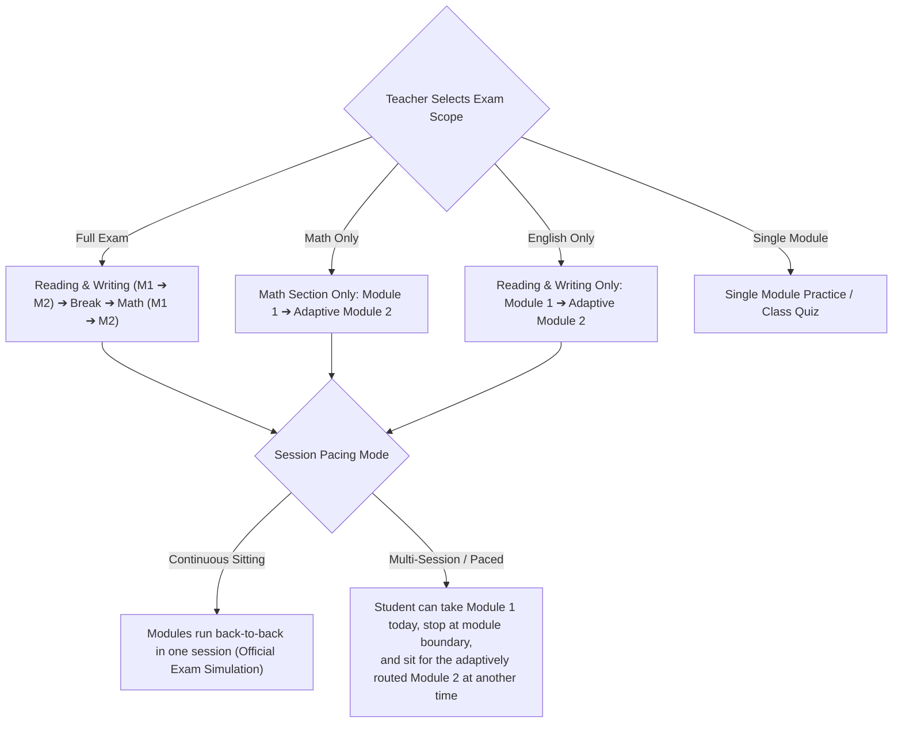
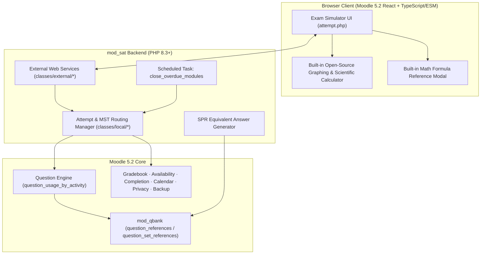

# Technical Specification & Architecture Plan: `mod_sat`
## Digital SAT Exam Simulator for Moodle 5.2+

| Property | Value |
| :--- | :--- |
| **Plugin Component** | `mod_sat` |
| **Repository** | `https://github.com/Smartlearn-edu/moodle-mod_sat` |
| **Local Workspace** | `/home/mohammad/Dev/plugins/mod/sat/` |
| **Target Moodle Version** | **Moodle 5.2+ only** (No 4.x legacy code) |
| **Server Baseline (Moodle 5.2)** | PHP 8.3+ (64-bit), PostgreSQL 16+ / MySQL 8.4+ / MariaDB 10.11+ |
| **License** | GNU General Public License v3 or later (100% open-source, self-contained) |
| **Author & Copyright** | `2026 Mohammad Nabil <mohammad@smartlearn.education>`, SmartLearn |
| **Plan Version** | v3.0 (Official SAT Exam Spec · Zero Proprietary UI/Third-Party Dependencies) |

> [!IMPORTANT]
> ### Intellectual Property & Non-Affiliation Mandate
> 1. **Zero Proprietary Cloning**: This plugin does **not** copy, imitate, or reference the visual trade dress, logos, color schemes, or proprietary branding of any commercial testing software. It uses an original, clean **Moodle 5.2 / Bootstrap 5 / SmartLearn** interface designed around universal Computer-Based Testing (CBT) ergonomics.
> 2. **100% Self-Hosted Open-Source Tools**: All exam tools (including the built-in Graphing & Scientific Calculator and Math Reference Sheet) are rendered locally using open-source GPL/MIT-compatible libraries bundled with the plugin. No commercial third-party calculator APIs or external network calls are used.
> 3. **Standard Trademark Disclaimer**: *"SAT® is a trademark registered by the College Board, which is not affiliated with, and does not endorse, this plugin."*

---

## 1. Official Digital SAT Exam Specification

The simulator is engineered around the official structure, domains, skills, timing, and adaptive mechanics of the Digital SAT assessment:

### 1.1 Exam Structure & Timing

| Section | Module 1 (Routing) | Module 2 (Adaptive) | Total Questions | Total Time |Question Formats |
| :--- | :--- | :--- | :--- | :--- | :--- |
| **1. Reading and Writing (RW)** | **27 Questions** *(25 scored + 2 pretest)* **32 minutes** | **27 Questions** *(25 scored + 2 pretest)* **32 minutes** | **54 Questions** | **64 minutes** | 100% 4-Option Multiple Choice ($A, B, C, D$) with short stimulus passages (25–150 words, tables, or bulleted notes). |
| **Scheduled Break** | — | — | — | **10 minutes** | Timed transition screen between sections (in Full Exam mode). |
| **2. Math** | **22 Questions** *(20 scored + 2 pretest)* **35 minutes** | **22 Questions** *(20 scored + 2 pretest)* **35 minutes** | **44 Questions** | **70 minutes** | ~75% 4-Option Multiple Choice ($A, B, C, D$) ~25% Student-Produced Response (SPR / Free-Response numeric input). |
| **Full Exam Total** | **49 Questions (67m)** | **49 Questions (67m)** | **98 Questions** | **134 minutes** *(+10m break)* | Multi-Stage Adaptive Testing (MST) per section. |

### 1.2 Official Content Domains & Skill Taxonomy

Questions in Moodle's Question Bank are tagged using these official domains and skills to drive **Blueprint Validation** (Phase 1) and **Diagnostic Analytics** (Phase 2):

#### A. Reading and Writing Domains (Ordered sequentially within each module)
1. **Craft and Structure (~28% / 13–15 questions)**
   * *Words in Context* (`rw-words-in-context`)
   * *Text Structure and Purpose* (`rw-text-structure-purpose`)
   * *Cross-Text Connections* (`rw-cross-text-connections`)
2. **Information and Ideas (~26% / 12–14 questions)**
   * *Central Ideas and Details* (`rw-central-ideas`)
   * *Command of Evidence: Textual* (`rw-evidence-textual`)
   * *Command of Evidence: Quantitative* (`rw-evidence-quantitative`)
   * *Inferences* (`rw-inferences`)
3. **Standard English Conventions (~26% / 11–13 questions)**
   * *Boundaries* (`rw-conventions-boundaries`)
   * *Form, Structure, and Sense* (`rw-conventions-form-structure`)
4. **Expression of Ideas (~20% / 8–12 questions)**
   * *Transitions* (`rw-transitions`)
   * *Rhetorical Synthesis* (`rw-rhetorical-synthesis`)

#### B. Math Domains (Ordered by increasing difficulty within each module)
1. **Algebra (~35% / 13–15 questions)**
   * *Linear equations in one variable* (`math-linear-eq-1v`)
   * *Linear equations in two variables* (`math-linear-eq-2v`)
   * *Linear functions* (`math-linear-functions`)
   * *Systems of two linear equations in two variables* (`math-linear-systems`)
   * *Linear inequalities in one or two variables* (`math-linear-inequalities`)
2. **Advanced Math (~35% / 13–15 questions)**
   * *Equivalent expressions* (`math-equivalent-expressions`)
   * *Nonlinear equations in one variable and systems in two variables* (`math-nonlinear-equations`)
   * *Nonlinear functions* (`math-nonlinear-functions`)
3. **Problem-Solving and Data Analysis (~15% / 5–7 questions)**
   * *Ratios, rates, proportional relationships, and units* (`math-ratios-rates`)
   * *Percentages* (`math-percentages`)
   * *One-variable data: distributions and measures of center and spread* (`math-data-1v`)
   * *Two-variable data: models and scatterplots* (`math-data-2v`)
   * *Probability and conditional probability* (`math-probability`)
   * *Inference from sample statistics and margin of error* (`math-statistical-inference`)
   * *Evaluating statistical claims: observational studies and experiments* (`math-statistical-claims`)
4. **Geometry and Trigonometry (~15% / 5–7 questions)**
   * *Area and volume* (`math-area-volume`)
   * *Lines, angles, and triangles* (`math-lines-angles-triangles`)
   * *Right triangles and trigonometry* (`math-right-triangles-trig`)
   * *Circles* (`math-circles`)

### 1.3 Student-Produced Response (SPR) Rules for Math
* **Character Limit**: Maximum **5 characters** for positive values; maximum **6 characters** for negative values (including the leading `-` sign).
* **Allowed Characters**: Digits (`0–9`), decimal point (`.`), fraction slash (`/`), and leading negative sign (`-`). No spaces, commas, mixed fractions (`1 1/2`), percent signs, or variables.
* **Equivalence & Precision Rules**:
  * Equivalent fractions and decimals are accepted (e.g., `1/2`, `2/4`, `.5`, `0.5`).
  * Repeating or long decimals must be **truncated or rounded to fill the maximum character width** (e.g., for $\frac{2}{3}$, accepted forms are `2/3`, `.6666`, `.6667`, `0.666`, `0.667`; short approximations like `.66` or `0.67` are rejected).

---

## 2. Flexible School & Preparatory Operating Modes

While the official exam is taken in a single 2-hour-14-minute sitting, classroom and prep environments require modular flexibility for Math and English teachers:

### Key Pacing Rules:
1. **Within a Module**: Once a module is started, its server clock runs continuously until submitted or expired (`timedeadline = timestart + timelimit × multiplier`).
2. **Between Modules (Multi-Session / Paced Mode)**:
   * As soon as the student submits Module 1, the backend evaluates Module 1's scored questions, locks in the adaptive route (`easy` or `hard` Module 2), and appends the routed Module 2 questions to the attempt.
   * The student sees a transition summary screen: *"Module 1 Complete. You may start Module 2 now or return later to continue."*
   * Answer review/explanations remain locked until all modules in the attempt are completed so no information leaks between sessions.

---

## 3. Core Architecture Decisions for Moodle 5.2+

| ID | Architectural Decision | Rationale |
| :--- | :--- | :--- |
| **A1** | **Target Moodle 5.2+ Exclusively** | Eliminates all Moodle 4.x legacy question-bank shims. Uses Moodle 5.2's native React/TypeScript/ESM frontend pipeline and `mod_qbank` (`question_references`) architecture. |
| **A2** | **Single Self-Contained Plugin (`mod_sat`)** | Uses Moodle's native **Question Engine** (`question_usage_by_activity`) with standard `qtype_multichoice`, `qtype_shortanswer`, and `qtype_numerical`. Includes a built-in **SPR Answer Expander** inside `mod_sat` that automatically generates valid SAT decimal/fraction answers on `qtype_shortanswer` questions—no extra `qtype` plugin installation required. |
| **A3** | **Native Question References (`question_references` & `question_set_references`)** | Supports both **Fixed Curated Forms** (exact questions in official domain/difficulty order) and **Random/Filtered Slots** (pulling by category + domain/difficulty tag). |
| **A4** | **Built-in Open-Source Graphing & Scientific Calculator** | Self-hosted calculator built with open-source GPL/MIT math plotting libraries (`JSXGraph` / `mathjs` / HTML5 Canvas) bundled directly in the plugin. Works 100% offline with zero commercial API keys or privacy leaks. |
| **A5** | **Server-Authoritative Timing & Scheduled Task** | Deadlines are enforced strictly on the server. A Moodle scheduled task (`\mod_sat\task\close_overdue_modules`) automatically submits expired modules and computes routing even if the student closes their browser. |
| **A6** | **Estimated Adaptive Scaled Scoring (200–800 / 400–1600)** | Lookup curve in `mdl_sat_score_tables` maps `(section, route, raw_percentage)` to scaled scores (200–800 per section, 400–1600 composite) and syncs with the Moodle Gradebook in Phase 1. |

---

## 4. Moodle 5.2 Subsystem Integration

### 4.1 Question Authoring & Stimulus/Question Split
* **Standard Moodle Question Types**:
  * **Multiple Choice**: `qtype_multichoice` (4 choices, single answer).
  * **Math SPR (Grid-In)**: `qtype_shortanswer` or `qtype_numerical`. When a teacher configures a slot as SPR in `mod_sat` and enters a canonical value (e.g., `2/3` or `-1.5`), `mod_sat`'s `spr_helper` automatically generates the full set of SAT-accepted answer rows (`2/3`, `.6666`, `.6667`, `0.666`, `0.667`) in the question's answer table.
* **Dual-Column Stimulus Split**:
  * For questions with a reading passage, poem, table, or multi-paragraph stimulus, placing a standard horizontal rule (`
`) in `questiontext` places everything before `
` into the **Left Stimulus Pane** (with text highlighting and notes enabled) and everything after `
` into the **Right Question Pane**.
  * If no `
` is present in Reading & Writing, the passage renders in the left pane and the options render in the right pane; in Math, single-pane questions render in a centered layout alongside theSPR directions when applicable.
* **Media & LaTeX Support**:
  * Implements `mod_sat_question_pluginfile()` in `lib.php` and formats all question text and choices through `format_text()` so images, SVG graphs, and MathJax/KaTeX equations render seamlessly.

### 4.2 Standard Moodle Quiz-Equivalent Features
* **Timing**: `timeopen`, `timeclose`, customizable per-module durations, server-side grace period.
* **User & Group Overrides (`mdl_sat_overrides`)**: Supports accommodations such as **1.5× extended time** (48m RW / 52.5m Math), **2.0× extended time** (64m RW / 70m Math), custom open/close dates, and extra attempts.
* **Attempts & Grading Method**: Configurable max attempts ($1, 2, \dots, \text{Unlimited}$) and grading method (*Highest score*, *Average score*, *First attempt*, *Last attempt*).
* **Review Options**: Configurable bitmask controlling when students can see their scores, submitted responses, correct answers, and explanations (*Immediately after module*, *After full attempt completion*, *After exam close date*).
* **Restrict Access & Completion**: Full support for Moodle's conditional availability (`core_availability`) and custom completion rules (*View*, *Complete all modules*, *Receive grade*, *Receive passing score*).
* **Backup/Restore & Privacy API**: Full `backup/moodle2` implementation and GDPR `core_privacy` provider (zero external third-party data processors).

---

## 5. Database Schema (`db/install.xml`)

1. **`mdl_sat`** *(Activity settings)*
   * `id`, `course`, `name`, `intro`, `introformat`
   * `exam_scope`: `varchar(20)` (`full`, `rw_only`, `math_only`, `single_module`)
   * `pacing_mode`: `varchar(20)` (`continuous`, `paced`)
   * `routing_mode`: `varchar(20)` (`adaptive`, `fixed`)
   * `timeopen`, `timeclose`, `graceperiod`, `breakduration`: `bigint(10)`
   * `attempts`: `int(4)`, `grademethod`: `smallint(4)`
   * `threshold_rw`, `threshold_math`: `int(4)` *(Percentage of scored marks in Module 1 required for Harder Module 2, default `60`)*
   * `reviewoptions`: `bigint(10)`
   * `grade`: `bigint(10)` *(1600 for full exam, 800 for single section)*
   * `timecreated`, `timemodified`: `bigint(10)`

2. **`mdl_sat_modules`** *(Module definitions within an exam instance)*
   * `id`, `satid`, `section` (`rw`, `math`), `stage` (`m1`, `m2_easy`, `m2_hard`, `m2_fixed`), `timelimit`, `questioncount`, `sortorder`

3. **`mdl_sat_slots`** *(Question slots within a module)*
   * `id`, `satid`, `moduleid`, `slot` (order inside module), `maxmark`, `is_scored` (`1` = operational, `0` = unscored pretest), `is_spr` (`1` = math free-response grid-in, `0` = MCQ), `slottype` (`fixed`, `random`)
   * *Linked to Moodle 5.2 `mdl_question_references` (for fixed questions) or `mdl_question_set_references` (for random filtered questions) using `component = 'mod_sat'`, `questionarea = 'slot'`, `itemid = mdl_sat_slots.id`.*

4. **`mdl_sat_attempts`** *(Overall student exam attempts)*
   * `id`, `satid`, `userid`, `attempt`, `uniqueid` *(FK to `mdl_question_usages.id`)*
   * `state`: `varchar(20)` (`inprogress`, `paused`, `finished`, `abandoned`)
   * `currentstage`: `varchar(20)` (`rw_m1`, `rw_m2`, `break`, `math_m1`, `math_m2`, `completed`)
   * `route_rw`, `route_math`: `varchar(10)` (`easy`, `hard`, `fixed`, `none`)
   * `preview`: `smallint(1)`
   * `raw_rw`, `raw_math`, `scaled_rw`, `scaled_math`, `scaled_total`: `int(6)`
   * `timestart`, `timefinish`, `timemodified`: `bigint(10)`

5. **`mdl_sat_module_attempts`** *(Per-module attempt timing & state)*
   * `id`, `attemptid`, `moduleid`, `state` (`notstarted`, `inprogress`, `finished`)
   * `firstslot`, `lastslot`: `int(6)` *(Slot range in the question usage)*
   * `timestart`, `timedeadline`, `timefinish`: `bigint(10)`
   * `rawscore`, `maxscore`: `numeric(10,5)`

6. **`mdl_sat_slot_state`** *(Student exam workspace tools state per question)*
   * `id`, `attemptid`, `slot`
   * `eliminated`: `text` *(JSON array of crossed-out choice indices)*
   * `annotations`: `text` *(JSON array of stimulus text highlight ranges and notes)*
   * `timemodified`: `bigint(10)`

7. **`mdl_sat_overrides`** *(User and group accommodations)*
   * `id`, `satid`, `groupid`, `userid`, `timeopen`, `timeclose`, `attempts`, `timemultiplier` (`numeric(4,2)`, e.g. `1.50`, `2.00`)

8. **`mdl_sat_grades`** *(Final aggregated grade per user)*
   * `id`, `satid`, `userid`, `grade`, `scaled_rw`, `scaled_math`, `timemodified`

9. **`mdl_sat_score_tables`** *(Configurable Raw % $\rightarrow$ 200–800 Scaled Score lookup curves)*
   * `id`, `satid` (`0` = default curve), `section` (`rw`, `math`), `route` (`easy`, `hard`), `rawpercent`, `scaledscore`

---

## 6. Simulator User Interface (Original Design, Zero Trademarked Style)

The exam runner (`attempt.php`) uses Moodle's minimal/embedded layout and mounts a clean, responsive **Moodle 5.2 React + TypeScript** application styled with scoped Bootstrap 5 variables (`.path-mod-sat`):

1. **Header Bar**:
   * Current Section & Module title (e.g., *Reading and Writing — Module 1 of 2*).
   * **Countdown Timer**: Centered `MM:SS` display with a *Hide/Show* toggle; automatically stays visible with an alert badge during the final 5 minutes.
   * **Exam Toolbar**:
     * **Graphing & Scientific Calculator** (Math section): Opens a draggable, resizable self-hosted calculator panel supporting multi-function graphing ($f(x)$), intersection/root tracing, and scientific calculations.
     * **Math Reference Sheet** (Math section): Opens a modal displaying universal geometry & trigonometry formulas (area, circumference, volume, Pythagorean theorem, special right triangles, radians) rendered via original SVG diagrams and LaTeX.
     * **Passage Highlighter & Notes** (RW section): Select text in the stimulus to highlight or attach a note.
     * **Display Options**: Font size zoom and high-contrast toggle.
2. **Question Workspace**:
   * **Split-Pane View**: Left column for reading passages/tables; right column for question stem and options.
   * **Multiple Choice**: Radio options $A, B, C, D$ (respecting Moodle's `_order` shuffle mapping) with an **Eliminate Option** (strikethrough) toggle button beside each choice.
   * **Student-Produced Response (SPR)**: Live character-validated input box (max 5 chars positive / 6 chars negative) with live mathematical fraction preview and standard entry instructions in the left pane.
   * **Flag for Review**: Bookmark toggle mapped directly to the Moodle Question Engine flag state.
3. **Footer Bar & Navigation Matrix**:
   * Question counter (*Question X of Y*) that opens a popover grid showing all questions in the current module (*Current*, *Answered*, *Unanswered*, *Flagged for Review*).
   * *Previous* and *Next* buttons.
4. **End-of-Module Review & Transition**:
   * Summary table of all questions in the module before final submission.
   * In **Continuous Mode**: Transitions directly to Module 2 (or the 10-minute Break screen between RW and Math).
   * In **Paced / Multi-Session Mode**: Displays a completion card allowing the student to either proceed immediately to the next module or exit safely and resume at a later time.

---

## 7. Phased Implementation Plan

### Phase 1: Core Plugin, Exam Engine & Simulator UI
1. **Plugin Scaffolding & Database (`mod_sat`)**:
   * `version.php` (Moodle 5.2+, PHP 8.3+), `db/install.xml`, `db/access.php`, `db/services.php`, `db/tasks.php`, `lib.php`, `settings.php`, `lang/en/sat.php`.
   * Default adaptive score conversion tables (`200–800` per section) seeded on install.
2. **Question Engine, Reference Manager & SPR Expander**:
   * `classes/local/attempt_manager.php`: Manages `question_usage_by_activity`, server-side deadlines, and dynamic mid-attempt appending of routed Module 2 questions.
   * `classes/local/mst_router.php` & `classes/local/scorer.php`: Evaluates Module 1 percentage against threshold, assigns Easy/Hard Module 2 route, computes scaled scores, and updates Moodle Gradebook (`grade_update`).
   * `classes/local/spr_helper.php`: Validates SPR input and populates equivalent fraction/decimal answers on `qtype_shortanswer` questions.
3. **Teacher Management Pages**:
   * `mod_form.php`: Exam scope (Full, RW, Math, Single Module), Pacing (Continuous vs. Paced), Routing (Adaptive vs. Fixed), Timing, Attempts, Review Options, Restrict Access, Completion.
   * `edit.php`: Module & Slot builder connected to Moodle 5.2's `mod_qbank` (`question_references` / `question_set_references`), with 1-click official module presets (27 RW / 22 Math) and SPR answer expander.
   * `overrides.php`: User and group time accommodations (1.5×, 2.0×, custom dates).
   * `report.php`: Basic teacher attempts report (student, module progress, route taken, raw & scaled scores, CSV export, regrade/delete).
4. **Student Pages & React Exam Simulator**:
   * `view.php`: Activity summary, attempt history, module-by-module status (with *Resume Module 2* button for Paced mode).
   * `attempt.php` + React/TypeScript UI: Split-pane workspace, timer, option eliminator, passage highlighter, built-in open-source Graphing/Scientific Calculator, Math Reference modal, question navigation matrix, and module review screen.
   * `review.php`: Post-attempt review page honoring the teacher's configured review options.
5. **Moodle Compliance & Automated Tests**:
   * Backup & Restore (`backup/moodle2/`), Privacy API (`classes/privacy/provider.php`), Scheduled Task (`close_overdue_modules`), and PHPUnit tests for routing, scoring, and SPR validation.
   * Sample original question bank XML (Math & RW across all domains) for immediate testing.

### Phase 2: Advanced Diagnostic Reporting & Analytics
1. **Student Diagnostic Report**:
   * Detailed score report showing Total Score (400–1600), Section Scores (200–800), and performance bars across all **8 Official SAT Domains** and **19 Sub-Skills** (derived from Moodle Question Tags).
   * Time-spent-per-question analytics and question-by-question explanation review.
2. **Teacher Cohort & Class Analytics**:
   * Class score distribution histograms, Easy vs. Hard routing rates, and Domain/Skill mastery heatmaps to identify class-wide weaknesses for targeted instruction.
   * Printable / PDF diagnostic score reports for students and parents.
